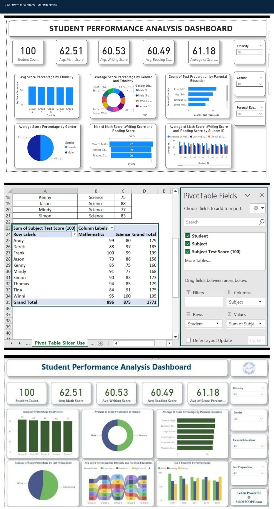

Student Performance Analysis Dashboard

Project Overview

A data analytics project created using sample data for 100 students to analyze Math, Reading, and Writing performance.

Tools Used

- Microsoft Excel
- SQL
- Power BI

Excel Skills

- VLOOKUP
- COUNTIF
- Pivot Tables
- Slicers

SQL Skills

- GROUP BY
- Data aggregation
- Result analysis

Key Insights

- Total Students: 100
- Average Math Score: 62.51
- Average Writing Score: 60.53
- Average Reading Score: 60.49
- Overall Average Score: 61.18

Dashboard Analysis

- Gender-wise performance
- Ethnicity-wise performance
- Parental Education analysis
- Test Preparation analysis
- Top 5 student performance

Dataset

This is a self-created sample dataset for learning and portfolio purposes. It does not contain real student records.

Learning Outcomes

- Data Analysis
- Data Visualization
- Dashboard Development
- SQL Reporting
## Dashboard Preview

